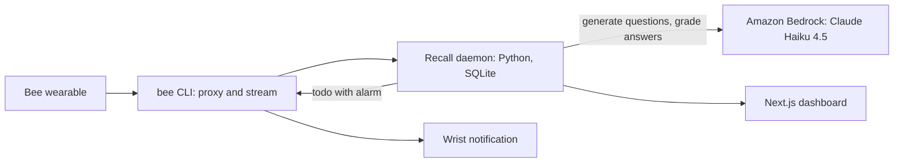

# Recall

**Bee remembers what you heard. Recall makes sure you do.**

Recall turns the learning sessions your Bee wearable captures into spaced-retrieval quizzes. Questions arrive as Bee todo alarms on your wrist, you answer out loud, and Recall grades what Bee heard and schedules the next review.

Status: working prototype, built for the Amazon Developer Hackathon 2026 (Bee track). Developed and tested on Windows 11.
Demo Video : https://youtu.be/sL0tVlvPoSE

## What it does

- **Learns from learning sessions only.** After a lecture or study session ends, Recall pulls the transcript through the Bee CLI, classifies it, and has Claude Haiku 4.5 on Amazon Bedrock write short questions (each with a rubric and the source excerpt it came from). Casual and personal conversations are skipped.
- **Pull, not push.** Recall nudges you with a todo after a lecture and at set points in your active hours, then waits. You start a session by ticking the ready todo or saying "Hey Bee, let's do a Recall session."
- **One question at a time.** Each question is sent as a Bee todo with an alarm ("Recall quiz, no hints: ..."). You answer out loud. Recall reads Bee's live transcript while you talk and treats the answer as finished once nothing new has arrived for 15 seconds and the last words are at least 40 seconds old. If nothing is said for 4 minutes the question is recorded as no answer, the session ends, and nothing is penalized.
- **Graded against a rubric.** Claude Haiku 4.5 on Bedrock grades your transcript against the question's rubric (quality 0 to 5) and the result is sent back as a Bee todo. SM-2 spaced repetition decides when each question comes back.
- **A report when it ends.** "N answered, X solid, Y need another look, Z-day streak", plus a read-only dashboard (Today, Progress, Sessions, Privacy).

## How it works



The daemon (`python -m recall.run`) runs four supervised loops: the live Bee event stream, a 5-second poller for realtime transcripts, a 10-second loop that advances the open session, and a 60-second loop for ingestion, classification, nudges and cleanup. Session state lives in SQLite, so a restart resumes where it left off.

## Setup

Prerequisites:

- Python 3.11 or newer (the code uses `datetime.UTC`)
- Node.js 20 or newer
- A Bee account and wearable, and the Bee CLI
- An AWS account with model access to Claude Haiku 4.5 enabled in the Amazon Bedrock console for your region

```
npm install -g @beeai/cli
bee login
```

```
python -m venv .venv
source .venv/Scripts/activate
python -m pip install -r requirements.txt
cp .env.example .env
```

Edit `.env`: set `AWS_ACCESS_KEY_ID`, `AWS_SECRET_ACCESS_KEY`, `AWS_REGION`, `LLM_MODEL` (the Claude Haiku 4.5 inference profile ID from the Bedrock docs), `TIMEZONE`, and optionally `ACTIVE_WINDOW`, `DAILY_QUOTA`, `DAY_RESET` and `MAX_STINGS`. The daemon starts `bee proxy` itself, so you do not run it by hand.

## Run

```
python -m recall.run --dry-run
python -m recall.run
```

`--dry-run` does everything except post or delete todos and call the LLM. To restart the daemon automatically if it ever exits, run `bash scripts/run_forever.sh` instead.

Useful commands:

```
python -m recall.status
python -m recall.questions --pending
python -m recall.questions --approve SESSION_ID
python -m recall.questions --reject-question QUESTION_ID
python -m pytest
```

Lecture sessions are auto-approved; substantive discussions wait for `--approve`.

### Dashboard

```
python -m uvicorn recall.api:app --port 8000
cd web
npm install
npm run dev
```

Open http://localhost:3000. The page reads the API at `http://localhost:8000` (override with `NEXT_PUBLIC_API_BASE_URL`). A red banner appears if the daemon has stopped ticking.

## Privacy

- Recall reads transcripts that Bee produces through the Bee CLI. It never records or touches audio.
- Only learning sessions generate questions. Casual and personal conversations are classified and skipped, and the Privacy page lists every ignored session and the reason.
- Your spoken answers and the start phrase are never reused as source material for new questions.
- Transcript text is sent to Amazon Bedrock to write and grade questions. Apart from that and the Bee API calls the Bee CLI makes, nothing leaves your machine.
- The database, logs and `.env` are gitignored and never committed.

## Known limitations

- Grading is strict on detail points: an answer that misses one rubric detail is usually graded partial.
- The Bee proxy can die while the dashboard heartbeat stays green. The heartbeat only proves the daemon's loop is ticking; a dead proxy shows up as repeated failures in `logs/recall-run.log`.
- Bee rewrites todo text into its own voice, so the wording that reaches the wrist can differ from the stored question.
- Bedrock calls are capped at 80 per day.
- Notifications can arrive 15 to 60 seconds late, and a spoken session start can take from seconds to minutes to register, depending on how fast Bee processes the conversation.
- Transcription quality is Bee's. Mis-transcribed speech lowers grade accuracy.

## Next

Multilingual support is planned.

## Repository layout

- `recall/`: the daemon, session state machine, grading, SM-2, API
- `web/`: Next.js dashboard
- `tests/`: pytest suite
- `video/`: Remotion project for the demo video (source only)
- `FRICTION_LOG.md`: running notes on building against the Bee developer platform
- `AGENT.md`: the standing project brief the coding agent follows

## Built with

Bee CLI (proxy, live stream, todos with alarms), Python (FastAPI, SQLModel, SQLite), Amazon Bedrock with Claude Haiku 4.5, Next.js.

## License

MIT. See [LICENSE](LICENSE).
